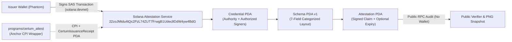

# Certum

Certum is an institutional credential issuance and public verification platform built natively on the **Solana Attestation Service (SAS)** (`22zoJMtdu4tQc2PzL74ZUT7FrwgB1Udec8DdW4yw4BdG`).

Universities, technical bootcamps, accreditation boards, and public agencies sign and anchor categorized credentials directly from their own Solana wallet. Graduates, employers, and auditors inspect any Attestation PDA or verification URL with zero wallet login required and export a 2x HiDPI PNG certificate snapshot.

## Architecture



### 1. Solana Program (`programs/certum_attest`)
- **Framework & Crates**: `anchor-lang` `0.32.3`, `solana-attestation-service-client` `1.0.9`, `borsh` `1.5.5`.
- **`issue_attestation_via_sas`**: CPI wrapper invoking `CreateAttestationCpi` into the official SAS program while recording an on-chain `CertumIssuanceReceipt` PDA (`["receipt", attestation_pubkey]`).
- **`verify_sas_attestation`**: On-chain verifier checking SAS program ownership, Borsh account decoding, credential/schema links, authorized signers, pause state, and expiration.

### 2. Frontend (`frontend/`)
- **Stack**: React 19, Vite 7, TypeScript 5.9, Bootstrap 5.3.9, Bootstrap Icons, Motion, Sonner, Fontsource (`@fontsource-variable/onest` and `@fontsource-variable/jetbrains-mono`).
- **Solana SDK Stack**: `@solana/kit` (`^8.6.0`), `@solana/react` (`^8.6.0`), `@solana/kit-plugin-rpc` (`^0.23.0`), `@solana/kit-plugin-wallet` (`^0.23.0`), and `@solana/attestation` (`2.1.0`).
- **Views**:
  - **Overview (`/`)**: Hero with live credential preview, instant PDA lookup, institutional scope, and 3-step SAS lifecycle.
  - **Issue Credential (`/issue`)**: Category selector (`Academic Degree`, `Bootcamp & Cohort`, `Professional License`, `Public & Civic Record`), Devnet pre-flight confirmation modal with live balance check, transaction resource simulation (CU & rent), and automatic on-chain history sync via `getProgramAccounts` (`memcmp` at byte offset `33`).
  - **Verify Record (`/verify` and `/verify/:attestationAddress`)**: Zero-wallet cryptographic audit of SAS ownership, PDA seeds, authorized signer, schema integrity, and expiry, plus 2x HiDPI HTML5 Canvas PNG snapshot export and social sharing.

## Schema Layout (v1)

Certum derives a deterministic `Credential PDA` (`"Certum Public Credentials"`) and `Schema PDA` (`"Public Credential"`, version `1`) with 7 typed string fields, while remaining backward-compatible with legacy 6-field records:

| Field | Type | Purpose |
| --- | --- | --- |
| `category` | `String` | Credential classification (`Academic Degree`, `Bootcamp & Cohort`, `Professional License`, `Public & Civic Record`) |
| `title` | `String` | Official credential, degree, or license title |
| `issuerDisplayName` | `String` | Issuing university, bootcamp, board, or public agency |
| `recipientDisplayName` | `String` | Recipient full name |
| `issueDate` | `String` | ISO calendar date (`YYYY-MM-DD`) |
| `expiryDate` | `String` | Optional ISO calendar date synchronized with SAS `expiry` timestamp |
| `description` | `String` | Public summary of credential scope or honors |

## Local Verification & Build

```sh
# 1. Rust program unit tests
cargo test --manifest-path Cargo.toml

# 2. Frontend install, unit tests, production build, and dev server
npm --prefix frontend install
npm --prefix frontend test
npm --prefix frontend run build
npm --prefix frontend run dev
```

## License

Released under the GNU General Public License v3.0 ([LICENSE](LICENSE)).
